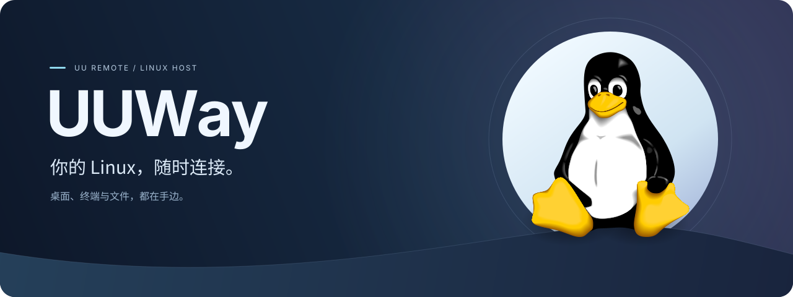
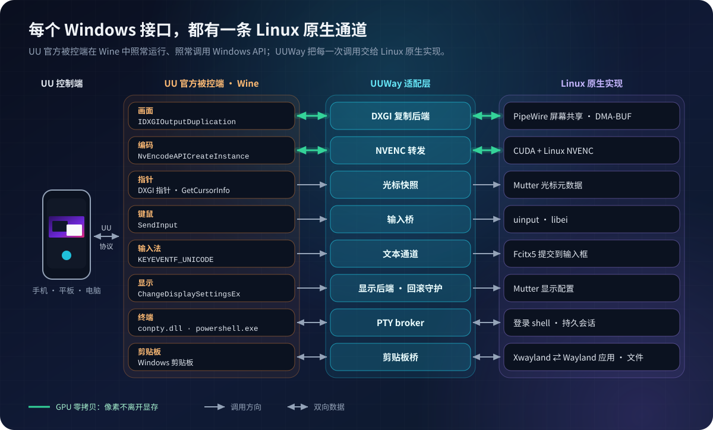
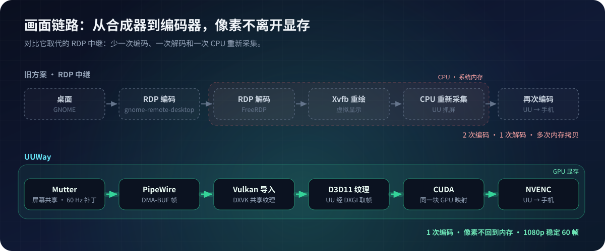

<div align="center">



[简体中文](README.md) · [English](README.en.md)


</div>

UUWay 让官方 Windows 版 UU 远程被控端在 Linux 上运行，用手机或其他设备控制你的桌面。UU 程序文件保持原样，画面、输入和显示管理由 Linux 原生组件适配。

## 功能

- **画面与输入**：NVIDIA NVENC 或 AMD VA-API H.264/HEVC，键鼠控制、真实光标、Fcitx5 中文输入。
- **多屏与超级屏**：各屏独立采集和调整分辨率、刷新率、缩放；超级屏支持独占，退出或异常结束后恢复原屏。
- **终端与文件**：Linux 登录 shell、多终端会话、双向文本剪贴板和文件传输。
- **控制台**：管理服务、输入、显示器、文件目录和软件更新。支持手动/自动检查更新，确认后才安装。

## 安装

主线使用 **GNOME Wayland** 桌面，搭配支持 NVENC 的 NVIDIA 显卡或支持 H.264/HEVC VA-API 的 AMD 显卡。Ubuntu 24.04 / GNOME 46 是参考环境，Ubuntu 26.04 也已有适配和实测。桌面须保持登录；无显示器时需有可用的桌面输出，例如显示器诱骗器。

1. 从 [Releases](https://github.com/GaryOAO/UUWay/releases/latest) 下载 `.deb`，并准备官方 Windows 版 UU 安装包。
2. 安装并以普通用户运行向导：

   ```bash
   sudo apt install ./uuway_*_amd64.deb
   uuway setup --installer ~/Downloads/UURemote_Setup.exe
   ```

3. 按提示登录 UU，允许屏幕共享和文字服务。完成后从应用菜单打开 **UUWay 控制台**，即可在控制端连接。

发布包以 Ubuntu 24.04 构建，其他版本如遇依赖差异可[从源码构建](docs/build.md)。向导会安装并固定 Wine 11、验证编码后端、配置用户服务；可重复运行。优先选择 NVIDIA，验证失败后尝试 AMD，不会安装或切换显卡驱动。Fcitx5 插件首次启用后需重启输入法：`fcitx5 -r`。

## 常用操作

```bash
uuway doctor                  # 检查环境和服务
uuway update                  # 检查更新
uuway update install          # 安装更新
uuway update status           # 查看更新结果
uuway update rollback         # 回滚更新
uuway refresh --restart-display # 重载显示服务，会移除现有超级屏
```

控制台默认在打开期间每 6 小时检查一次更新，可关闭自动检查。更新会短暂断开远程连接。OTA 安装适用于 `.deb` 安装，源码安装请更新源码后重新构建。

仅远程使用可手动启用 `uuway autologin on`，让 GDM 自动登录并在桌面退出后重新登录；任何能接触机器的人也能进入桌面，启用前请了解这一影响。关闭：`uuway autologin off`。

卸载：先运行 `uuway uninstall`，再运行 `sudo apt remove uuway`。Wine 前缀和 UU 登录信息会保留。

## 支持范围

| 环境 | 验证情况 |
| --- | --- |
| Ubuntu 24.04 · GNOME 46 Wayland · RTX 3090 | 维护者日常使用与回归验证 |
| Ubuntu 26.04 · GNOME Wayland · Radeon 780M | [社区实机连接验证](https://github.com/GaryOAO/UUWay/pull/4)；已适配 Python 3.14 文字服务与 [OSC 3008 终端乱码](https://github.com/GaryOAO/UUWay/issues/2) |
| Manjaro · KDE Plasma / KWin Wayland | [用户报告可用](https://github.com/GaryOAO/UUWay/issues/14)，使用社区 KDE 适配分支；主线安装器仍面向 GNOME |

其他环境欢迎提交[兼容性报告](https://github.com/GaryOAO/UUWay/issues/new?template=compatibility-report.yml)。

- 最多 8 块活动显示器；暂不支持镜像布局、旋转和 Intel 单显卡编码。AMD 使用内存中转，NVIDIA 使用 GPU 零拷贝链路。
- 超级屏仍可能出现双光标。分辨率、刷新率和串流性能取决于显示模式、驱动及硬件，最高 144 Hz 模式不代表串流帧率保证。
- 只服务已登录的桌面会话，不支持 GDM 登录界面。显示布局临时应用；永久布局请在 GNOME 设置中保存。

## 工作原理

账号、连接和码率协商仍由 UU 处理。图中的 GPU 零拷贝链路适用于 NVIDIA；AMD 使用内存中转。





## 开发

```bash
git clone https://github.com/GaryOAO/UUWay.git
cd UUWay
./install.sh --installer ~/Downloads/UURemote_Setup.exe
```

[构建与排错](docs/build.md) · [架构设计](docs/design.md) · [超级屏与故障恢复](docs/super-screen-lifecycle.md) · [AMD 后端](docs/amd-vaapi.md)

## 许可证与致谢

[GNU AGPL-3.0](LICENSE)。UUWay 是独立的非官方项目，与网易无关，不分发 UU 程序文件。

源于 [uu-remote-ubuntu-bridge](https://github.com/lachlanchen/uu-remote-ubuntu-bridge)，并建立在 [Wine](https://www.winehq.org/)、[DXVK](https://github.com/doitsujin/dxvk)、PipeWire 与 Mutter 之上。
